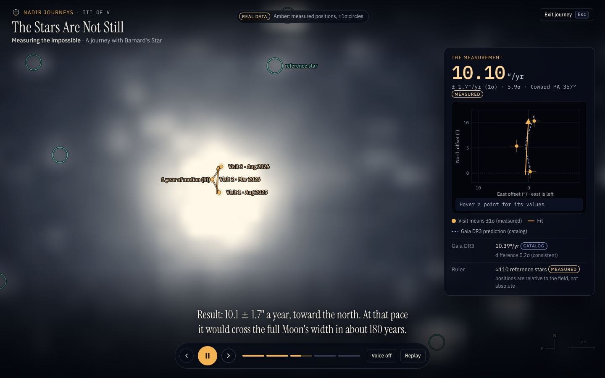

# NADIR Journeys

A planetarium-style guided show about one object, played over the live
observatory with real SPHEREx frames. The first complete journey is
**The Stars Are Not Still**, about Barnard's Star. It runs about 90 seconds,
in five scenes.

To start one, select a source and press **Take a journey** in its dossier.
You can pause, go to the previous or next scene, replay, or exit at any point.
Captions are always shown; a voice is optional and off by default. When the
show ends it offers **Explore it yourself**, **View the scientific evidence** and
**Return to the observatory**. On exit the observatory is restored exactly:
selection, tab, comparison mode, A/B pair, overlays and camera.



## Scenes (Barnard's Star)

| # | Scene | What is shown | Evidence |
|---|---|---|---|
| I | The still sky | Real frame; slow zoom to the star; identity card | Type/distance/temperature **catalog** (SIMBAD, Gaia DR3); exposures and saturation **measured**; 1916 discovery **literature** (Barnard 1916, AJ 29, 181) |
| II | The passage of time | One real, wavelength-matched frame per server visit (3 visits, 393 days), then a blink of first ↔ last; teal reference stars | Frames and registration residuals **measured**; nothing interpolated |
| III | Measuring the impossible | Visit-mean positions with ±1σ circles at true scale, fitted 1-year arrow, path chart; then 2MASS 2000 → AllWISE 2010 → Gaia 2016 positions | Motion **measured** (10.10 ± 1.7″/yr, 5.9σ); Gaia DR3 and history **catalog**; calibration caveat stated |
| IV | Reading light | Barnard is saturated, so no spectrum, and the narration says so. The show then moves to a named, unsaturated neighbour, labelled "a different star" | Spectrum **measured**; colour model **inferred**; SIMBAD type, Gaia T and 2MASS/WISE **catalog** |
| V | Becoming the observer | Whole field; the two rejected look-alikes; a checklist of how the claim was tested | Tiers and checks **measured** |

Every number in a caption or card is computed from the API payload at run
time (see `journey/science.js`). The story only adds tone: titles, two
opening lines and one literature note.

## Architecture

```
frontend/js/journey/
  engine.js    JourneyEngine — one clock, scenes, beats, navigation (no DOM; node-tested)
  journeys.js  scene factories + registry: journeyFor(detail)
  science.js   pure data choices: visit frames, reference stars, spectral demo, motion facts
  views.js     evidence cards and compact charts (shared by Stage A and Stage B)
  ui.js        JourneyUI (overlay, captions, controls, voice) + Lessons (Stage B)
frontend/css/journey.css
```

**Declarative scenes.** A scene is a plain object:

```js
{ id, title,
  when(ctx)          // include it for this object? (e.g. only measured movers get "measure")
  prepare(ctx)       // async data; throwing selects `fallback`
  enter(ctx, data)   // camera, frame, sky layer for the start of the scene
  card(ctx, data)    // evidence card HTML (every value tagged)
  beats(ctx, data)   // [{ at: ms, caption, stamp, card, do(ctx) }]
  fallback(ctx, err) // honest replacement when data is missing or a fetch fails
  duration, final,
  explore(ctx, data) // Stage B lesson that reuses this scene's data }
```

**One clock.** The engine advances time only while playing. It fires beats
in order and moves on when a scene's duration is reached. The blink is a set
of beats, not a `setInterval`, so pausing and skipping behave the same as
everywhere else. Every scene change increments a generation counter, so data
that arrives late for an abandoned scene can never touch the stage. Each
scene's `prepare` is memoised and warmed at start. If a `prepare`, `enter`,
`card` or beat throws, the error is caught: the scene shows its fallback (or a
generic "could not be prepared" caption) and the show continues.

**Context, not globals.** Scenes reach the app only through `ctx`, built in
`main.js`:

- `frame(i)` shows a real registered exposure;
- `fly(x, y, k, ms)` moves the camera over a log-zoom, framed in the area
  that captions and cards leave clear;
- `layer()` / `reveal()` drive the sky's journey layer: reference rings,
  rejected ×, measured trail, fitted arrow, catalog history and focus
  brackets;
- `spectrum(id)` reads spectra with `cached_only=true`;
- `app.*` drives the live observatory in Stage B.

Every `ctx` call is a no-op once the journey has ended or the field has
changed.

**Sky integration.** `SkyView` gained `flyTo()` (instant under reduced
motion, and cancelled by any pan or zoom), `kForSpan()` and `drawJourney()`.
Selection flash, camera moves and reveals now share one guarded animation
loop. While a journey is active the normal overlays are switched to the
Clean preset, and the journey layer replaces the selection reticle.

**New journeys.** `journeyFor(detail)` returns Barnard's full show when SIMBAD
names Barnard's Star. Any other source gets the same scene factories with
neutral titles, and `when` drops any scene its data cannot support. For
example, a rejected or stationary source gets no "measure" scene and makes no
motion claim. To add a themed journey (brown dwarf, variable, galaxy), add a
story and the scene list to the registry, and add a scene factory only for a
new kind of evidence. No new player or overlay is needed.

## Stage B — Explore it yourself

Each scene may define `explore(ctx, data)`. The lessons reuse the data that
Stage A already prepared, and act on the real instruments rather than
copies:

1. **Find it yourself:** centre the star.
2. **Blink the visits yourself:** set A/B to the first and last visit, then
   Blink or B − A.
3. **Check the measurement:** open the Motion evidence, or turn on reference
   stars.
4. **Read the light:** open the demonstration star's Spectrum tab.
5. **Record your observation:** a notebook saved to the same key as the
   dossier's Notes tab.

There are no quizzes. Planned next steps for Stage B:

- prompts for comparing two stars;
- "predict, then check": guess the position in the next visit, then blink;
- an uncertainty sandbox that shows how dropping a visit changes the fit.

The last two need a server endpoint that refits with a chosen subset of
visits. That would be a backend contract, so it is listed here and not
implemented in the frontend.

### Future: Reconstruction Lab (planned UI only)

Codex is developing reconstruction methods on a separate branch. A future
"Reconstruction Lab" scene could compare an observed frame with a
reconstruction side by side. It would always be labelled **inferred**, show
the method and its residual map, and never replace an observed frame in the
motion or time scenes. Nothing in this milestone calls or simulates such an
endpoint.

## Scientific accuracy and limitations

- **Only observed frames.** Time scenes show one registered exposure per
  server visit, all within 2% of the anchor wavelength. The blink alternates
  two real frames. No frame is interpolated or synthesised, and the browser
  test records every displayed frame index and checks it against the usable
  epochs.
- **The trail is measured.** Amber dots are the server's visit-mean
  positions; circles are their 1σ errors at true angular scale. The arrow is
  the fitted motion over one year (`fit.offset_* + fit.pm_*`). Catalog
  positions are blue and the stamp marks them "catalog, not SPHEREx".
- **Not independent validation.** Barnard's per-visit systematic floor was
  calibrated on Barnard against Gaia. The caption and card say that the 0.2σ
  agreement is a consistency check, not proof.
- **No spectrum is invented.** Barnard's core is masked in 100% of its
  exposures, so the show states the limitation. It then moves to an
  unsaturated catalog star from the same images, named on screen and in the
  stamp ("Now showing a different star"). That star is chosen
  automatically, with SIMBAD-typed stars first, and must pass the same
  caveats the dossier uses:
  - at least 40 measurements;
  - colour-model χ²ᵣ ≤ 3, with the temperature range bounded;
  - at least two catalog comparisons.

  In the cached Barnard field this selects TYC 425-262-1 (SIMBAD A3V, 152
  fluxes, χ²ᵣ 2.4, within 7% of 2MASS/AllWISE). Its colour temperature
  (≈6,800 K) is labelled as a model fit, not a surface temperature. Gaia's
  ≈8,390 K model estimate is shown beside it as catalog data. The
  closer-agreeing TYC 425-223-1 was not used because its fit has χ²ᵣ 7.3,
  which the dossier itself flags as a poor fit.
- **Failures are narrated.** If the spectral images cannot be read (tested by
  forcing HTTP 503), the scene says so and the show continues. If a source
  has fewer than two comparable visits, the time scene says that change
  cannot be shown, and does not pretend.
- **Display only.** Presentation smoothing, vignette, captions and camera
  moves never alter measurements. The stamp always says which exposure (date
  and λ) is on screen.
- **Literature.** The 1916 discovery note is the only statement not drawn
  from NADIR data. It carries a dashed "literature" tag and a citation.
- **Known gaps:**
  - Voice uses the browser's speech synthesis, so quality varies by
    platform. It is off by default, the engine waits at most an estimated
    reading time, and it was not exercised in headless tests.
  - The journey only uses cached spectra. On a clean machine, run
    `scripts/prepare_demo.py --only barnard --spectra barnard` while online
    first; otherwise scene IV narrates the gap.
  - While testing, `GET /api/fields/{fid}/sources/21/spectrum` returned
    HTTP 500 in the Barnard field. That is a backend issue, not changed
    here; the journey skips failing candidates.

## Verification

```bash
node --test tests/journey.test.mjs           # engine timing, navigation, failure fallbacks, data choices
.venv/bin/python scripts/verify_journey.py --url http://127.0.0.1:8001 --out artifacts/journey
```

`verify_journey.py` runs 34 browser checks:

- start the journey from the dossier, with focus on the play button;
- Space pauses (the clock is frozen) and resumes;
- skip and previous, including rapid key spam;
- every displayed frame is a real usable epoch;
- the main playback timers stay idle;
- the measurement card carries its provenance tags;
- the catalog history is labelled as catalog;
- the hand-over to "a different star" in the spectrum scene;
- the end actions;
- the observatory is restored exactly after exit;
- Esc exits;
- Evidence opens the Motion tab;
- Explore-it-yourself drives Blink and saves notes;
- a compact journey for a rejected source makes no motion claim;
- a failed spectrum fetch is narrated honestly;
- reduced motion: instant camera, no flourish, immediate reveals;
- mobile: no overflow, the evidence card starts collapsed and the toggle
  works.

Screenshots of every scene at desktop and mobile widths go to
`artifacts/journey/`. A selection is committed in `docs/screenshots/journey-*.jpg`.
